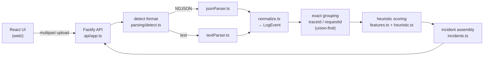

# Incident Lens

Upload log files from several services; Incident Lens parses and normalizes them, correlates related events into **incidents**, and shows an ordered **timeline** for each one.

Correlation is deterministic and explainable:

- **Exact** — events that share a `traceId` or `requestId` (transitively; one event carrying both bridges the two).
- **Heuristic** — when no shared ID exists, nearby WARN/ERROR events are scored on time proximity, shared endpoint, shared error code, shared keywords, one service naming the other, and severity. Each heuristic link carries a **confidence score and the reasons behind it**, and the UI labels it as inferred rather than proven.

No LLM is involved in this iteration.

## Run

**Docker (recommended)**

```bash
docker build -t incident-lens .
docker run --rm -p 3000:3000 incident-lens
```

Open http://localhost:3000 and click **Analyze sample logs**, or drop your own files.

**Local (Node 20+)**

```bash
npm install
npm test          # 69 tests (Vitest)
npm run build
npm start         # http://localhost:3000
```

For development: `npm run dev:server` and `npm run dev:web` (Vite on :5173 proxies `/api` to :3000).

**API**

```bash
curl -F files=@samples/api-gateway.log -F files=@samples/order-service.jsonl \
     -F windowMs=5000 -F minConfidence=0.5 http://localhost:3000/api/analyze
```

`POST /api/analyze/samples` analyzes the bundled `samples/` directory.

## Architecture



Processing happens in memory and stays in memory (no database). `analyze()` in `server/src/analyze.ts` is a pure function that runs the whole pipeline, which keeps it easy to test.

### Correlation algorithm (`server/src/correlation/incidents.ts`)

1. **Exact groups**: union-find over events that share any `traceId=` or `requestId=` key.
2. **Heuristic edges**: for every pair of WARN+ events from different groups within `windowMs` (and at least one is ERROR+), compute a score. Keep the best edge per group pair if `score ≥ minConfidence`.
3. **Incidents**: connected components of groups. A component counts as an incident only if it contains an ERROR or FATAL event.
4. **Explanation**: starting from the anchor group (the earliest error), groups are attached strongest link first (Prim's algorithm). So every heuristic member reports the *one* link that justified it, with its confidence and reasons. The incident's confidence is its **weakest** link.

| Signal | Weight |
| --- | --- |
| Time proximity (linear decay over the window) | 0.30 |
| Shared endpoint/path (IDs collapsed: `/orders/123` → `/orders/:id`) | 0.20 |
| Shared error code (HTTP 4xx/5xx, `SNAKE_CASE`, `ECONNREFUSED`) | 0.20 |
| Shared keywords (overlap coefficient, generic words removed) | 0.15 |
| One service's message names the other service | 0.10 |
| Both events ERROR or above | 0.05 |

Time + service mention + severity together reach at most 0.45, below the default 0.5 threshold. **So events are never linked just for being close in time.** They also need a shared endpoint, error code, or keywords.

## Input formats

- **NDJSON**: one JSON object per line. Common aliases are recognized: `timestamp|@timestamp|time|ts`, `level|severity|log.level` (strings or pino numeric levels), `message|msg`, `traceId|trace_id|trace.id`, `requestId|request_id|correlationId`, `service|service.name`. Other fields are kept as metadata.
- **Text**: `<timestamp> <LEVEL> [logger]? message key=value ...`, for example `2026-11-10 08:20:01,850 ERROR [db-pool] DB_CONN_TIMEOUT ...`. `trace_id=` and `request_id=` pairs are extracted, and indented continuation lines (stack traces) attach to the previous event.
- The format is detected per file. The service name defaults to the filename up to the first dot (`order-service.jsonl` → `order-service`).

## Assumptions and limits

- Timestamps with no time zone are treated as UTC. Numeric timestamps below 1e12 are epoch seconds; larger ones are milliseconds.
- Lines that can't be parsed (bad JSON, missing timestamp) are reported as warnings with file and line number; they don't fail the request.
- Cost stays bounded for hostile input:
  - Upload limits are 10 MB per file, 20 files, and 200k events (beyond that the API returns 413).
  - Each WARN/ERROR event is compared with at most 50 following events in the window.
  - Text lines are truncated to 16 KB before parsing.
  - Heuristic feature extraction reads only the first 4 KB of a message.
- Epoch numbers are read as seconds, milliseconds, microseconds or nanoseconds depending on their size. Timestamps without a time zone are treated as UTC. Values outside 1970–2200 are rejected.
- Placeholder correlation IDs (all zeros, `-`, `null`, `unknown`, …) are ignored, so they don't merge unrelated events.
- **Known limitation:** heuristic links chain transitively. A steady stream of similar errors, each one closer to the next than the time window, can become one long incident even though its endpoints are far apart. Each link's own confidence is still shown. A later iteration could cap incident span, or score new members against the anchor.
- Clock skew between services is not corrected.

## Project layout

```
server/src/parsing/       detect, JSON + text parsers, normalization
server/src/correlation/   feature extraction, heuristic scoring, incident assembly
server/src/api/           Fastify routes (upload, samples, static UI)
server/test/              Vitest: parsing, normalization, correlation, API end-to-end
web/src/                  React UI
samples/                  4 services, mixed formats; 3 incidents + unrelated noise
docs/AI_WORKFLOW.md       how this was built with AI
```

## AI-assisted workflow

See [docs/AI_WORKFLOW.md](docs/AI_WORKFLOW.md).
