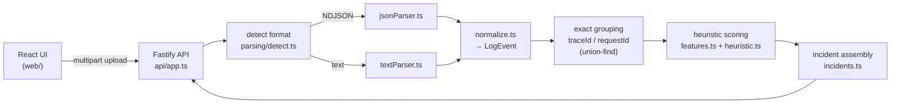

# Incident Lens

Upload log files from several services; Incident Lens parses and normalizes them, correlates related events into **incidents**, and shows an ordered **timeline** for each one.

Correlation is deterministic and explainable:

- **Exact** — events that share a `traceId` or `requestId` (transitively; one event carrying both bridges the two).
- **Heuristic** — when no shared ID exists, nearby WARN/ERROR events can still be linked, but only if they share real evidence (an endpoint, error code or keyword). Each heuristic link carries a **heuristic score and the reasons behind it**, and the UI labels it as inferred rather than proven.

Runtime correlation is intentionally deterministic in this version. An LLM could later summarize already-correlated evidence or suggest investigation steps. It is not used to decide which events belong to the same incident.

## Run

**Docker (recommended)**

```bash
docker build -t incident-lens .
docker run --rm -p 3000:3000 incident-lens
```

Open http://localhost:3000, then:

1. Click **Load sample logs**; the four bundled files appear in the current file batch. Or drop or choose your own files.
2. Click **Analyze**. Samples and uploads go through the same analysis request.

One analysis covers one batch: the files currently in the list.
- Adding or removing a file clears the previous result; press **Analyze** again.
- **Clear files** resets the workspace.
- The time window and minimum heuristic score are under **Advanced settings**.

**Local (Node 20+)**

```bash
npm install
npm test          # 84 automated tests (Vitest: 76 server, 8 web)
npm run build
npm start         # http://localhost:3000
```

For development: `npm run dev:server` and `npm run dev:web` (Vite on :5173 proxies `/api` to :3000).

**API**

```bash
curl -F files=@samples/api-gateway.log -F files=@samples/order-service.jsonl \
     -F windowMs=5000 -F minConfidence=0.5 http://localhost:3000/api/analyze
```

`minConfidence` is the API name for the minimum heuristic score.
- `GET /api/samples` lists the bundled samples.
- `GET /api/samples/:name` returns one sample as text. The UI loads samples this way.
- `POST /api/analyze/samples` analyzes the samples directly, for scripted demos.

## What the sample demonstrates

`samples/` holds logs from four services in mixed JSON and text formats. Analyzing all four gives:

- **INC-001, exact.** A checkout failure across api-gateway, order-service and payment-service, linked purely by trace and request IDs.
- **INC-002, heuristic (min score 0.56).** An inventory-service database timeout with no IDs, linked to the order-service and api-gateway errors.
  - The links come from a shared endpoint, the 503 status, error code and keywords, plus order-service naming inventory-service.
  - The order and gateway errors are themselves linked to each other exactly, by request ID.
- **INC-003, isolated.** A single config-reload error with nothing related.
- **False-positive avoidance.** A TLS-certificate WARN and a rate-limit WARN within a second of INC-002 share no evidence with it and stay out.
  - An inventory connection-pool WARN 3 s before the timeout shares a keyword but scores too low, so it also stays out. That shows the cost of conservative rules.

## Architecture



Processing happens in memory and stays in memory (no database). `analyze()` in `server/src/analyze.ts` is a pure function that runs the whole pipeline, which keeps it easy to test.

### Correlation algorithm (`server/src/correlation/incidents.ts`)

1. **Exact groups:** union-find over events that share any `traceId=` or `requestId=` key.
2. **Heuristic edges:** score pairs of events from different groups that meet all of these conditions:
   - both are WARN or above, and at least one is ERROR or above;
   - they are within `windowMs` of each other;
   - they share at least one evidence signal (see below).

   Keep the best edge per group pair if its score is at least the minimum heuristic score.
3. **Incidents:** connected components of groups. A component counts as an incident only if it contains an ERROR or FATAL event.
4. **Explanation:** starting from the anchor group (the earliest error), groups are attached strongest link first (Prim's algorithm).
   - Each heuristic member reports the *one* link that justified it, with its score and reasons.
   - The incident's score is its **weakest** link, shown in the UI as e.g. "min score 0.56".

**Evidence requirement.** A heuristic link must share at least one substantive evidence signal: a shared endpoint/path, error code, or meaningful keyword.
- Time proximity, severity and service-name mentions can strengthen a score, but cannot create a link on their own.
- This holds whatever minimum heuristic score is configured. Two unrelated errors 100 ms apart stay separate even at a threshold of 0, and tests cover this.

| Signal | Weight |
| --- | --- |
| Time proximity (linear decay over the window) | 0.30 |
| Shared endpoint/path (IDs collapsed: `/orders/123` → `/orders/:id`) | 0.20 (evidence) |
| Shared error code (HTTP 4xx/5xx, `SNAKE_CASE`, `ECONNREFUSED`) | 0.20 (evidence) |
| Shared keywords (overlap coefficient, generic words removed) | up to 0.15 (evidence) |
| One service's message names the other service | 0.10 |
| Both events ERROR or above | 0.05 |

The weights are hand-picked prototype values that encode relative evidence strength. They are not statistically calibrated. **The heuristic score is a hand-tuned evidence score, not a calibrated probability.** A score of 0.56 does not mean a 56% probability that two events belong to the same incident. It is used to filter and rank inferred links; the default minimum is 0.5.

## Input formats

- **NDJSON**: one JSON object per line. Common aliases are recognized: `timestamp|@timestamp|time|ts`, `level|severity|log.level` (strings or pino numeric levels), `message|msg`, `traceId|trace_id|trace.id`, `requestId|request_id|correlationId`, `service|service.name`. Other fields are kept as metadata.
- **Text**: `<timestamp> <LEVEL> [logger]? message key=value ...`, for example `2026-11-10 08:20:01,850 ERROR [db-pool] DB_CONN_TIMEOUT ...`. `trace_id=` and `request_id=` pairs are extracted, and indented continuation lines (stack traces) attach to the previous event.
- The format is detected per file. The service name defaults to the filename up to the first dot (`order-service.jsonl` → `order-service`).

## Assumptions and limits

- **Timestamps:**
  - Timestamps without a time zone are treated as UTC.
  - Epoch numbers are read as seconds, milliseconds, microseconds or nanoseconds depending on their size.
  - Values outside 1970–2200 are rejected.
- Lines that can't be parsed (bad JSON, missing or invalid timestamp) are reported as warnings with file and line number. They don't fail the request.
- **Cost stays bounded for hostile input:**
  - Upload limits are 10 MB per file, 20 files, and 200k events (beyond that the API returns 413).
  - Each WARN/ERROR event is compared with at most 50 following events in the window.
  - Text lines are truncated to 16 KB before parsing.
  - Heuristic feature extraction reads only the first 4 KB of a message.
- Placeholder correlation IDs (all zeros, `-`, `null`, `unknown`, …) are ignored, so they don't merge unrelated events.
- **Known limitation: heuristic links chain transitively.**
  - A steady stream of similar errors, each closer to the next than the time window, can become one long incident even though its first and last events are far apart.
  - Each link's own heuristic score is still shown.
  - A later iteration could cap incident span, or score new members against the anchor.
- Clock skew between services is not corrected.

## Project layout

```
server/src/parsing/       detect, JSON + text parsers, normalization
server/src/correlation/   feature extraction, heuristic scoring, incident assembly
server/src/api/           Fastify routes (upload, samples, static UI)
server/test/              Vitest: parsing, normalization, correlation, API end-to-end, regressions
web/src/                  React UI; workspace.ts holds the current-batch state (tested in workspace.test.ts)
samples/                  4 services, mixed formats; 3 incidents + unrelated noise
docs/AI_WORKFLOW.md       how this was built with AI
```

## AI-assisted workflow

See [docs/AI_WORKFLOW.md](docs/AI_WORKFLOW.md).
